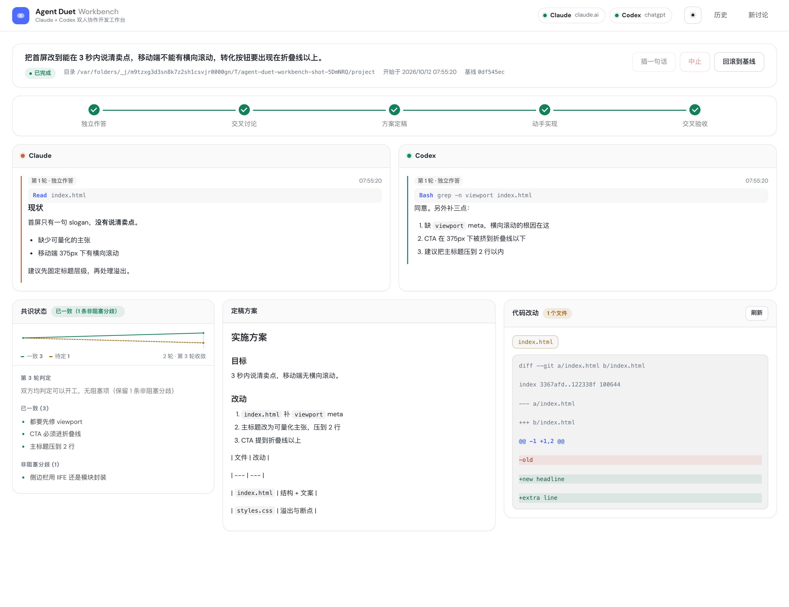

# Agent Duet Workbench · Claude × Codex 双人讨论台

你之前是手动把 Claude 的话复制到 Codex，再把 Codex 的回复复制回 Claude，来回几轮把方案磨好。Agent Duet Workbench 把这件事自动化了：

```
你写一次需求
   │
   ├─ 第 1 轮  两个 agent 各自独立作答（互相看不见，避免开局就被带偏）
   │
   ├─ 第 2..N 轮  互相补盲：各自读对方的方案，补上对方没看到的地方，合出一份方案
   │             每轮末尾输出结构化结论，账本清空就自动停
   │
   ├─ 定稿     由指定的一方把讨论收敛成一份无歧义的实施方案
   │
   ├─ 实现     真正改代码并自测（默认单写者；也可开分工，两人依次各写一部分）
   │
   └─ 验收     另一个 agent 读真实文件 + git diff，明确说「放行」或「打回」
               打回则带意见返工（次数可配）
```

跑完这一轮之后由你决定：**接着提需求**（带着上次的方案再来一遍），或者**验收通过**结束。

全程在一个本地网页里实时观看，双栏并排。界面有**浅色 / 深色 / 跟随系统**三态主题，右上角一键切换。



---

## 快速开始

```bash
cd agent-duet-workbench
node bin/agent-duet-workbench.mjs          # 会自动打开 http://127.0.0.1:8787
```

先自检环境：

```bash
node bin/agent-duet-workbench.mjs doctor
```

期望看到两个 `✔ 已登录`。任何一个显示未登录，按下面的「依赖」修。

其他用法：

```bash
node bin/agent-duet-workbench.mjs --port 9000     # 换端口
node bin/agent-duet-workbench.mjs --no-open       # 不自动开浏览器
```

---

## 依赖

Agent Duet Workbench 不装任何 npm 包（零依赖），但需要两个 CLI 已经装好并且**已登录**。

### Codex

ChatGPT 桌面版内置了 codex CLI，Agent Duet Workbench 会自动在下面这些位置找：

```
$AGENT_DUET_WORKBENCH_CODEX_BIN
~/.local/bin/codex
/Applications/ChatGPT.app/Contents/Resources/codex-cli/bin/codex
/Applications/Codex.app/Contents/Resources/codex-cli/bin/codex
```

用 ChatGPT 订阅登录即可，检查 `~/.codex/auth.json`。

### Claude Code

```bash
curl -fsSL https://claude.ai/install.sh | bash    # 装到 ~/.local/bin/claude
claude auth login                                  # 用 Claude 订阅登录（一次性）
```

查找顺序：`$AGENT_DUET_WORKBENCH_CLAUDE_BIN` → `~/.local/bin/claude` → `PATH` → Claude 桌面版内置 CLI。

> **注意**：Claude **桌面版**的登录态存在它自己的 Electron 会话里，命令行 CLI 读不到。
> 即使桌面版已登录，也必须单独跑一次 `claude auth login`。

### 自定义位置

```bash
export AGENT_DUET_WORKBENCH_CODEX_BIN=/path/to/codex
export AGENT_DUET_WORKBENCH_CLAUDE_BIN=/path/to/claude
```

---

## 界面

| 区域 | 作用 |
|---|---|
| 顶部圆点 | 两个 CLI 的安装 / 登录状态，红色表示要先修 |
| 历史侧栏 | 所有会话，带状态标签（进行中 / 待你确认 / 已完成 / 已中止 / 已中断 / 已失败）；悬停出现「删除」 |
| 双栏 | Claude 和 Codex 的发言，实时流式；工具调用（读了什么文件、跑了什么命令）也会显示 |
| 阶段条 | 当前处于 独立作答 / 交叉讨论 / 定稿 / 实现 / 验收 哪一步 |
| 共识状态 | 每轮机器判定的结果：已一致 / 分歧 / 阻塞项 |
| 收敛曲线 | 把「从分歧走向一致」画出来：实线是一致项，虚线是未决项（分歧+阻塞），收敛那轮有竖线 |
| 成本看板 | 这场讨论跑了多少轮、调了多少次模型、烧了多少钱 |
| 会话日志 | 「为什么停了」、追加了几轮、agent 报的错。默认隐藏，有内容才出现 |
| 定稿方案 | 讨论收敛后的最终 Markdown 方案 |
| 代码改动 | 文件清单 + 彩色 diff |

**一个会话 = 一个项目上的一件事，可以追加多次需求。** 点一次「开始讨论」生成一条记录，
工具不会把一次需求拆成多条；做完了还想改，就在**同一个会话里接着提**：
两个 agent 会带着上次交付的方案继续（并且续聊上次的 CLI 会话，记得之前谈过什么），
时间线、成本、阶段记录全部累积在同一条记录里。

**任务算不算做完由你判定。** 自动化流程跑完只把会话标成「待你确认」，
不会替你宣布「已完成」—— 你可以接着提需求，也可以点「验收通过」把它结束掉。
删除只清本地记录（`sessions/<id>/`），**不碰项目目录里的任何文件**；
正在运行的会话必须先中止才能删（服务端返回 409 拦下来）。

右上角按钮：

- **插一句话** —— 中途纠偏，而且**由你选怎么生效**：**排队**（不打断他们，下一个发言机会交给双方）
  或**立即执行**（打断当前这一轮，马上按新要求重跑）。会话已经停下时先记下来，
  下次继续的第一件事就交给双方。三种情况都会从此作为长期要求持续生效
- **接着提需求** —— 这一轮做完了继续加要求，还在同一个会话里（任何时候都可用）
- **验收通过** —— 由你宣布这件事结束了。只有点过它，状态才会变成「已完成」
- **中止** —— 停掉当前会话（已产生的改动保留）。一般 1 秒内两个 agent 子进程就都退出了
- **回滚到基线** —— 把项目目录重置回**最开始**那个基线（追加需求不会移动它）

---

## 安全设计

因为允许 agent 直接改代码，Agent Duet Workbench 做了三层保护：

1. **写入串行化** —— 实现阶段只有一个 agent 有写权限，另一个只验收，从机制上杜绝两个 agent 互相覆盖。
2. **git 检查点** —— 会话开始前、每次动手前都会自动 commit 一个检查点。随时可一键回滚。
   - 用的是你自己的仓库和当前分支；工作区干净时不会产生多余提交。
   - 提交身份显式写成 `Agent Duet Workbench <agent-duet-workbench@localhost>`，关闭 GPG 签名，不受你本地 git 配置影响。
   - **作用域严格限定在你选的项目目录内。** 如果该目录是某个更大仓库的子目录
     （monorepo 子包很常见），Agent Duet Workbench 只提交/回滚这一棵子树，绝不碰仓库其它地方的改动。
     界面会在会话头部常驻提示这一点。
     > 这条是踩过坑才加的：不带路径限定的 `git add -A` 等价于暂存**整个仓库**，
     > 会把用户无关的未提交改动一起吞进 agent-duet-workbench 的提交里，而 `git reset --hard` 回滚
     > 则会直接删掉它们。现在全部改成带路径限定的局部提交 + `git checkout <sha> -- .` 恢复。
3. **讨论阶段真只读** —— Codex 走 `--sandbox read-only`；Claude 通过 `--disallowedTools Edit Write NotebookEdit MultiEdit` 摘掉写文件能力。
4. **第 1 轮失败就停** —— 任一 agent 在第一轮就挂了（没登录、超时等），会话立即中止并报告原因，
   不会继续把额度烧在一个注定失败的会话上。
5. **插话不会被丢掉** —— 见下面「插一句话到底什么时候生效」。
6. **僵尸会话自动清理** —— 服务重启后，上次没跑完的会话会被标记为「已中断」，
   不会一直显示成「正在运行」卡在那里。
7. **进程清理** —— 服务退出（Ctrl+C / 被 kill / 异常）时，会把在跑的 agent 子进程
   一起带走。不做这件事的话，它们会被 launchd 收养、**继续连模型烧额度**，
   而输出已经没有任何人读 —— 你只会看到界面还在转圈，以为「他们还在跑」。

### 界面不会谎报「正在跑」

`turn.start` 挂上转圈，`turn.end` 才摘掉。但进程被杀时 `turn.end` 根本不会写进事件流。
所以界面显式做了两件事：会话不是真的在跑时**清掉所有转圈状态**，
并在头部用一个状态标签如实标出 `进行中 / 待你确认 / 已完成 / 已中止 / 已中断 / 已失败`
（「已中断」会把原因挂在 title 上）。

> 这个 bug 真实发生过：一个会话断在 03:45，界面一直转到 05:00 用户来问「他们还在跑啊」。
> 实际上一个 agent 进程都没有 —— 是界面在骗人。这比功能缺失更糟，
> 因为它让人对着一个永远不会有结果的界面等下去。

### 插一句话到底什么时候生效

模型调用一旦发出就没法中途改内容，所以**正在跑的那一轮插不进去** —— 最早只能等到下一个发言机会。
具体来说：

- 插话会进**下一个** turn 的提示词（任何阶段都算：作答 / 讨论 / 定稿 / 实现 / 验收）
- 一旦传达，它会成为**贯穿整个会话的长期要求**，不是只影响一轮
- 如果双方已经谈拢、但你的话还没传达完，会**追加一轮**把话带进去（最多多给 2 轮）
- 界面上会有明确回执：「已排队」→「已传达给双方」
- **可以选「立即执行」**：不等这一轮跑完，直接打断它并按新要求重跑。
  代价要说清：这一轮已经烧掉的额度不退回；在实现阶段，agent 正在改的文件可能停在改了一半的状态
  （每次动手前的检查点还在，随时可以回滚）。并发的两轮会拿到**同一份**要求，不会只纠正一方。
- **会话已经停下也照样收**：这时它会先记进这个会话（落盘，时间线上显示成一张「已记下」的卡片），
  等你点「接着提需求」时，第一件事就是把它交给双方。所以那颗按钮不会因为会话停了就变灰。

> 这里曾经会**静默丢数据**：旧代码在每轮讨论结束后无条件清空插话缓冲，
> 但插话只在**该轮开始之前**被读进提示词。于是「看到 agent 正在跑、才想插一句话」
> 这个最常见的情形下，插话既进不了当前这轮，又会被那行清掉 —— 彻底消失；
> 若这轮恰好收敛，连定稿都收不到。现在改成取用时才清空，并且每个阶段都会取。

> 实现阶段 Claude 使用 `--permission-mode bypassPermissions`。这是无头模式的必需项
> （没人能点「允许」），也意味着**它在该目录下可以执行任意命令**。
> 请只对信任的、有 git 兜底的项目目录使用。想更保守就把「写入权限」设为
> 「只讨论出方案，不动文件」。

---

## 产出物

每次会话在 `sessions/<id>/` 下落盘：

```
meta.json        会话元信息、检查点 SHA、状态
events.jsonl     完整事件流（前端重放用）
plan.md          定稿方案
transcript.md    人类可读的完整讨论记录
```

---

## 谁动手写代码

高级设置里的「第 1 轮之后由谁主导实现」有三档：

| 档位 | 谁写代码 | 谁验收 | 每轮模型调用 |
| --- | --- | --- | --- |
| Claude 实现 | Claude | Codex | 2 次 |
| Codex 实现 | Codex | Claude | 2 次 |
| 分工实现 | 两个都写 | 两个都验 | 4 次 |
| **由讨论决定**（推荐） | **他们商量完再定** | 同上 | 视决定而定 |

### 「由讨论决定」为什么是默认推荐

谁实现、要不要分工，**本来就不该由用户在开会前拍板** —— 任务是什么形状、
能不能切开、哪部分耦合紧，只有讨论完才知道。所以问的是他们俩。

讨论提示词里追加一个 `execution` 字段，每个 agent 都要回答：

```json
{ "execution": { "mode": "single", "implementer": "codex", "reason": "要改同一批文件，切开反而乱" } }
// 或
{ "execution": { "mode": "split", "reason": "按 parser / 测试两个模块切开很清楚" } }
```

裁定规则：

- 主导方主张分工 → 分工
- 主导方主张单干 → 单干（它同时是裁决方），并采纳它指明的实现者
- 两边都说不出 → 保守单干，并**明确警告**用户走了保守策略

决定之后会记一条日志：`讨论决定：分工实现，两人各写一部分（按模块切开很清楚）`。
**谁落地谁定稿** —— 方案要交到动手的那个人手里。

### 分工实现是怎么做的

两个 agent **依次**各写自己那部分，不是同时动手：

```
定稿（产出分工表，按文件切开）
   │
   ├─ Claude 写自己那部分 → 打检查点
   ├─ Codex 写自己那部分（能看到 Claude 的检查点，可读可依赖，但不能改）
   ├─ 合计 diff → Claude 验收
   └─            → Codex 验收（两人都放行才算过）
```

**为什么串行**：两个 agent 同时改同一批文件会互相覆盖，而且没有 worktree 隔离兜底，
出了冲突没法收拾。依次动手就没这个问题 —— 代价是慢一倍，换来的是两边都能写代码。

定稿提示词里硬性要求**按文件或模块切开**、两边不许碰同一个文件、工作量尽量相当。
组合数学上这仍然可能重叠（模型不一定会完全遵守），所以**验收的是合起来的 diff**，
两个人各验一遍，谁发现问题都能打回。

---

## 给 agent 多大权限

讨论阶段**始终只读**（这是安全设计，不随设置变化）。实现阶段由你选：

| 档位 | codex 沙箱 | 能做什么 |
| --- | --- | --- |
| `workspace`（默认） | `workspace-write` + **开网络** | 写项目目录、执行命令、**装依赖**；写不到项目之外 |
| `full` | `danger-full-access` | 完全不限，能改项目之外的任何文件 |

Claude 在实现阶段走 `--permission-mode bypassPermissions`（完全授权），讨论阶段用
`--disallowedTools` 摘掉 Edit / Write / NotebookEdit / MultiEdit。

### 为什么默认档要显式开网络

codex 的 `workspace-write` 沙箱**默认禁网**，于是 `npm install` / `pip install` 必然失败 ——
agent 会把「需要安装依赖」写进阻塞项，看起来像是你没授权，其实是沙箱没开网。

Duet 在这个档位下注入 `-c sandbox_workspace_write.network_access=true`。
实测（沙箱内 `curl example.com` 返回 200）：

```
真实会话验证：codex 在 /tmp 下
  edit: add .gitignore, check.js, lib/hello.js     ← 能写代码
  npm install --save-exact ms@2.1.3                ← 能联网装依赖
  node check.js > RESULT.txt                       ← 能执行
  验收放行（打回=false）
产物：RESULT.txt="OK 2000"、node_modules/ms@2.1.3、package.json 记录了依赖
```

这样比直接给 `danger-full-access` 安全得多：**能装依赖，但写不出项目目录**。

---

## 可调参数

在界面「高级设置」里改，或改 `src/config.mjs` 的 `DEFAULTS`：

| 参数 | 默认 | 说明 |
|---|---|---|
| `maxRounds` | 4 | 讨论轮数上限，到了即使没谈拢也进入定稿 |
| `minRounds` | 2 | 至少互评一次才允许判停 |
| `leadAgent` | claude | 由谁实现、由谁验收 |
| `allowWrite` | true | 关掉就只出方案不动文件 |
| `sandbox` | workspace | 实现阶段的授权级别：`workspace`（可写项目 + 可联网装依赖）/ `full`（完全不限） |
| `maxFixRounds` | 2 | 验收打回后最多返工几次 |
| `turnTimeoutMs` | 25 分钟 | 单轮超时 |

---

## 讨论会收敛吗

这是这个工具最核心的问题。**答案取决于任务形状，而不是让 agent「更努力」。**

### 先说框架：是搭档，不是对手

初版把讨论写成了「互相挑毛病」。这是错的，而且不只是文案问题：

**你让一个模型去找问题，它一定会找到问题。** 一个对抗性框架本身就是分歧的制造机 ——
它鼓励模型摆姿态、守立场、为了显得严谨而制造异议。实测过一个会话，
一致项一路涨到 22，**待定项也从 11 涨到 16**。那不是收敛，是在累积矛盾。

真正的价值在哪：**两个不同模型的盲区不一样**。一个漏掉的边界条件，
另一个可能恰好训练过；一个高估的地方，另一个可能踩过坑。
所以框架必须是「**补上对方看不到的地方**」，目的是**一起把方案做对，不是分出谁对**。

### 为什么两个 agent 天然不会收敛

给它们的任务里有两步是**无界生成**的：「指出对方的问题」「划出剩余分歧」。
一个足够详细的方案永远能挑出更多问题 —— 没有自然停止点。更糟的是有复利效应：
每轮合并后的方案都比上轮更详细，细节越多、可挑的地方越多。
所以分歧的供给是随进展**增长**的。

实测过一条真实轨迹（同一需求、同一上限）：

| 轮次 | 2 | 3 | 4 | 5 | 6 | 7 |
| --- | --- | --- | --- | --- | --- | --- |
| 一致项 | 12 | 18 | 19 | 21 | 22 | 22 |
| **待定项** | 11 | 11 | 12 | 11 | **16** | **16** |

一致项涨到 22 看着很热闹，但待定项**反弹到 16** —— 比第 2 轮还多。
那不是收敛，是在累积问题。

### 三个推手

**① 议题账本（最关键的一处）**

把任务从「找出问题」换成「回答这 N 个问题」：每条议题有稳定编号，跨轮持续存在，
agent 必须按编号表态（结案 / 仍阻塞 / 非阻塞）。列表是有限的，
每轮要么关掉它、要么不动 —— **收敛点从「互相满意」变成了「列表清空」，后者一定能到达。**

**② 从共识到决策完备**

方案质量并不需要全体一致，只需要**没有悬而未决的问题**。所以结案有两条路：
双方谈妥，**或者由负责实现的一方裁决**（谁动手谁定，跟真实团队一样）。
搭档用可判定的理由明确反对时，裁决可以再留一轮；连续两轮坚持即生效。

这把一个「共识问题」（可能无解）换成了「决策完备性问题」（一定有解）。

**③ 假阻塞的分类**

「外部前提」（需要凭据、需要实测环境、需要用户拍板）和「纯偏好」（两种都行）
**都不算阻塞** —— 它们再讨论一百轮也不会消失。前者写进方案的「前提条件」，
后者由实现方定。坚持阻塞必须给出可判定的依据。

### 提示词只能做到一半

模型是**软**的：它会一边说 `converged: true` 一边列阻塞项，也会无视编号自己造新议题。
所以分工是：

> **提示词决定任务的形状（能不能收敛）；代码负责执行协议（真的收敛了吗）。**

编排器不信模型的自述：收紧轮自己丢掉 `newIssues`，停滞由账本大小判定，
账本连续两轮不缩就停止讨论、转由定稿逐条裁决。

### 效果

同一需求（person agent，maxRounds=6，只讨论不写码）：

| | 改前 | 改后 |
| --- | --- | --- |
| 讨论轮数 | 6 轮跑满，**未收敛** | **1 轮** |
| 待定项 | 11 → **16** | **2**（且都被定稿逐条裁决） |
| 花费 | $2.48 | **$1.16** |

定稿方案里对每条待定议题都有带编号的裁决，例如：

```
**#1 Memory.key 是否必须来自固定白名单。裁决：采纳 Claude 的做法…**
    依据：可以验证。tests/test_memory_keys.py 用两种说法…
**#2 MVP 是否做 React/FastAPI 前端。裁决：采纳 Claude 的做法，MVP 不做 Web 前端。**
```

「待定」出现 0 次、「后续再确认」0 次 —— 方案交出去就能开工。

### 验证时抓到的一个假完备

第二次实测时出现了这样一幕：

```
第 2 轮议题账本已清空（0 条由主导方裁决），停止讨论
```

看着像"完美收敛"，其实是**假的**。查原始输出才发现：

```
[claude/discuss] 正文 61 字符
    You've hit your session limit · resets 6:50am (Asia/Shanghai)
```

Claude 额度用尽，把提示**当普通正文**返回，退出码还是 0 —— 于是这一轮被当成成功。
搭档看到垃圾输入，只能如实回答「没有可评议的方案」→ 零条议题 → 账本为空 → **被判成"完备"收工**。

垃圾输入被读成了"没有分歧"。修了三处：

1. 适配器识别额度提示，这一轮记失败而不是成功
2. **账本为空只有在双方都给出有效结论时才等于完备** —— 否则"没人提问题"会被当成"没有问题"
3. 额度用尽直接中止会话：它不会在几秒内恢复，继续跑只会单方面烧另一方的额度

第 2 条是真正的防线：即使适配器漏判，完备判定也不会被骗过去。

---

## 收敛是怎么判定的

讨论每轮的末尾，两个 agent 都被要求输出一个 JSON 代码块：

```json
{
  "converged": true,
  "agreements": ["已经一致的点"],
  "disagreements": ["不影响开工的分歧（写法偏好等）"],
  "blocking": ["动手前必须先解决的问题；没有就留空"],
  "next": "下一轮该聚焦什么"
}
```

停止条件以 **`blocking` 为唯一闸门**：

- 双方都写 `converged: true`，**且**汇总后的 `blocking` 为空 → 停。
- `disagreements` 只作记录，**不影响判停**。它表示「不影响开工的分歧」（两种写法都行、措辞偏好之类），
  仍然会照实展示在共识面板里。
- 任一方没吐出可解析的 JSON，都算没收敛（宁多聊一轮，不误判）。
- 无论如何都不会超过 `maxRounds`。

> 这里曾经有一处自相矛盾：提示词告诉 agent「`blocking` 是唯一的闸门」，
> 判停代码却额外要求 `disagreements` 也为空。后果是 agent 完全照做也**永远停不下来**，
> 讨论必定跑满上限 —— 自动判停形同虚设，还白白多烧额度。
> 现在提示词和判定逻辑共用同一套契约，并有单元测试钉住（`test/prompts.test.mjs`）。

### 还有一个更隐蔽的坑

修完上面那条之后，实测**仍然停不下来**。抓出双方各自的 verdict 才看清真正原因：

```
第 4 轮   Codex: converged = true,  分歧 0, 阻塞 0
         Claude: converged = false, 分歧 1, 阻塞 0
```

Codex 自己在第 2 轮写下了原因：

> 「当前方案**已经可以开工**…但 Claude 尚未认可缩减范围，**因此不能宣布双方已经收敛**。」

问题在于两个 agent 是**并行作答**的（`Promise.all`），本轮互相看不到对方的回答 ——
而我却让它们报告「你们俩是否达成一致」，这是它们**无法观测的状态**。它们只能保守地填 `false`。

修正后把 `converged` 明确为「**你自己**是否已经可以开工」，并告诉它们看不到对方本轮的回答。
真实重测（同一需求、同一上限）：

| | 修正前 | 修正后 |
| --- | --- | --- |
| 讨论轮数 | 3 轮（跑满上限） | **1 轮** |
| 模型调用 | 9 次 | **5 次** |
| 结果 | 未收敛 | 收敛（带着 5 条非阻塞分歧） |

---

## 测试

```bash
npm test          # 逻辑回归（零依赖、零额度消耗，109 条）
npm run test:ui   # 界面回归（无头 Chrome，79 条）
npm run shots     # 重新生成 docs/ 下的浅色/深色截图
```

`npm test` 覆盖四块最容易出人命的地方：

- **gitguard**（9 条）：核心是「项目目录是更大仓库的子目录时，checkpoint 与 rollback
  绝不触碰子目录之外的任何文件」—— 这是会丢数据的路径，所以逐条钉死。
  也覆盖路径基准一致性（`git diff` 输出仓库根相对、`git ls-files` 输出当前目录相对，
  混用会让 agent 拿到打不开的路径）。
- **orchestrator**（5 条）：用注入的假适配器离线驱动状态机，验证
  「第 1 轮有一方失败 → 立刻中止、不再调用搭档、不留下 running 僵尸会话」，
  以及「轮次进行中插入的话不会被静默丢弃」。
- **prompts**（15 条）：判停契约、verdict 解析容错，以及
  **提示词与判定逻辑必须一致**的防倒退闸门。
- **adapters**（9 条）：子进程登记与清理（见下面「进程清理」）、超时/中断、行解析。
- **server**（22 条）：僵尸会话对账、会话删除（含路径穿越与「不碰项目目录」的安全断言）、
  事件序号与续传契约、delta 合并的正确性（内容一字不差）。

`npm run test:ui` 用 Chrome DevTools Protocol 读**计算样式**和**命中测试**，
而不是检查 DOM 文本。这不是洁癖：曾经有个 bug 是 `.modal{display:flex}` 覆盖了 HTML 的
`hidden` 属性，导致弹窗永久盖住整个界面，而 DOM 内容完全正确 —— 只看 DOM 是发现不了的。
它还断言浅色与深色的**实际背景色确实不同**，以及**中断的会话不会显示成「还在跑」**。

测试跑在临时目录（`AGENT_DUET_WORKBENCH_SESSIONS_DIR`），不碰你的真实会话记录，也不调用任何模型。

---

## 性能

打开一个大会话时，界面曾经**冻住 5 秒**。实测定位到三个原因，都已修掉：

| 问题 | 修法 | 实测 |
| --- | --- | --- |
| 97% 的事件是流式碎片 `delta`，每条都触发一次 DOM 追加 + 强制布局 | 服务端合并连续的同 agent delta（语义等价：前端本来就是往同一个气泡追加文本） | 事件 7494 → **224**，体积 1.3MB → **400KB** |
| 每个事件被处理**两次**（HTTP 拉一遍重放，SSE 连上又重放一遍） | SSE 支持游标续传，前端把已收到的位置传回去 | 处理次数 2 → **1** |
| `/api/health` 每次都 spawn `claude auth status` 子进程 | 30 秒 TTL 缓存（`?fresh=1` 可强制刷新） | 405ms → **1ms** |

**打开会话：5099ms → 90ms（57 倍）。** 上面每个数字都是 CDP 实测，不是估算。

### 事件序号（seq）

每个事件带一个单调递增的 `seq`。这不是装饰，是**正确性**的一部分：

`EventSource` 断线重连时会用**同一个 URL** —— 如果「从哪继续」是按条数算的，重连时那个数
不会前进，服务端就会把已经处理过的历史**全部重发一遍**：消息重复渲染，而且每重放一个
`turn.start` 就多一个气泡，留下一堆**永远转圈的幽灵**（正是「他们还在跑啊」那类现象）。

所以：服务端按 `seq > after` 补发，前端自己去重、**自己管重连**并把游标推进。
老事件没有 seq，读取时按行号补 —— 文件只追加，而计数器正是从「已有行数」起算的，不会撞号。

---

## 视觉

设计令牌取自 deepseek.com 的实际 CSS 变量（`--ds-*`），做成本地的一套等价物：

| 令牌 | 浅色 | 深色 |
| --- | --- | --- |
| 页面底 | `#ffffff` 纯白 | `#0a0a0a` |
| 卡片 | `#ffffff` | `#141414` |
| 主文字 | `#1e232c` | `#ffffff` |
| 强调色 | `#4d6bfe` | `#6799fe` |
| 主按钮 | `#1a1615` 近黑 | `#ffffff` 反相 |

浅色是纯白底 + 白卡片，**靠边框和阴影分层**，跟常见工具站一样。

> 试过两版都不是纯白：
> - `#f9f8f8`（DeepSeek 的 `--ds-color-bg-page` 变量值）—— 比纯白暗 2.4%。
>   这点差异读不成"有意的分层"，只读成"白色不正、发灰"。
> - `#fdfeff` + 90px 网格（量自 deepseek.com/download 的实际渲染）—— 有结构，
>   但格子线在实用工具里是装饰噪声，不是信息。
>
> 结论：**要么明显分层，要么纯白靠边框，中间态最难看。** 现在走的是后者。

圆角 24/16/10，靠**边框分层**而不是重阴影，顶栏与弹窗用 12px 毛玻璃。
`auto` 主题在 JS 里就解析成具体的 `light`/`dark`，所以 CSS 只需要两套令牌、不必写第三套。

字体走 `DM Sans` + 系统字体栈，加载不到就回落，不阻塞渲染、也不影响离线使用。

---

## 已知限制

- **只在「接着提需求」的第一轮续聊**。同一个会话正常跑的时候，每一轮都把需要的上下文完整写进 prompt，
  行为可预测、失败可复现，代价是 token 消耗比 resume 高。只有追加需求后的第一轮会去续聊上次的 CLI 会话，
  让两个 agent 记得之前谈过什么；续聊会话失效时会自动退回全新一轮，不会把新需求弄丢。
- **成本**：Claude 每次调用都会重建系统提示缓存（首次约 12k token）。
  一个 4 轮会话大约几美元量级，跑之前心里有数。
- **只支持两个 agent**。要加第三个得改 `orchestrator.mjs` 里的 `['claude','codex']` 数组。
- **回滚不是 `git reset --hard`**：它用 `git checkout <基线> -- .` + `git clean -fd -- .` 把**项目目录内**
  恢复到基线，再把恢复出来的内容撤出暂存。不动 HEAD，也绝不碰项目目录之外的任何文件。
  代价是：基线之后 agent 的改动会被删掉（包括它们新建的文件），点之前确认。
  点错了也能救回来：每次检查点都是一个真实提交，`git log` 里能找到
  （message 以 `agent-duet-workbench:` 开头），用 `git checkout <那个提交> -- .` 即可取回。

---

## 目录结构

```
agent-duet-workbench/
├── bin/agent-duet-workbench.mjs    CLI 入口（start / doctor）
├── src/
│   ├── config.mjs            CLI 发现、认证探测、默认参数
│   ├── prompts.mjs           提示词 + verdict 解析 + 共识判定
│   ├── adapters/
│   │   ├── util.mjs          子进程流式执行 + 超时/中止 + 进程清理
│   │   ├── codex.mjs         驱动 codex exec --json
│   │   └── claude.mjs        驱动 claude -p stream-json
│   ├── orchestrator.mjs      状态机：作答→讨论→定稿→实现→验收
│   ├── gitguard.mjs          检查点 / diff / 回滚（严格作用域限定）
│   ├── session.mjs           会话持久化
│   └── server.mjs            HTTP + SSE + 僵尸会话对账
├── test/
│   ├── gitguard.test.mjs     git 安全回归（子目录越界是重点）
│   ├── orchestrator.test.mjs 状态机（假适配器，零额度）
│   ├── prompts.test.mjs      判停契约与 verdict 解析
│   ├── adapters.test.mjs     子进程生命周期（含进程清理）
│   ├── server.test.mjs       僵尸会话对账
│   ├── ui-check.mjs          界面回归（CDP 读计算样式 + 主题 + 状态）
│   └── screenshots.mjs       生成浅色/深色截图
├── public/                   前端（原生 JS，无构建）
└── sessions/                 会话产出（可用 AGENT_DUET_WORKBENCH_SESSIONS_DIR 改位置）
```
